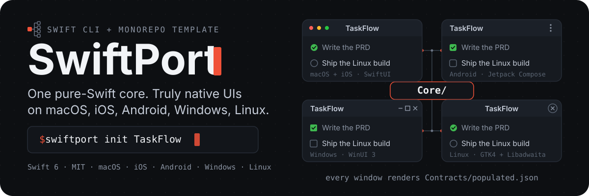
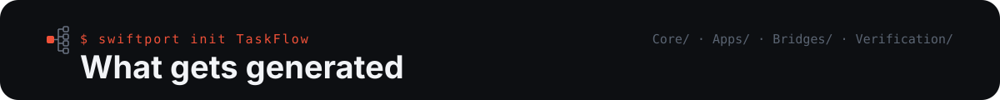
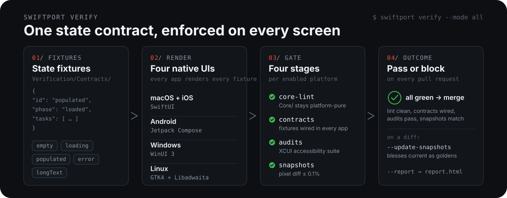

<p align="center">
  
</p>

<p align="center">
  <a href="https://github.com/VM451/SwiftPort/actions/workflows/ci.yml"></a>
  
  <a href="./LICENSE"></a>
</p>

**Apple-first, native-everywhere app scaffolding.** Write your app's core once in pure Swift — `swiftport init` scaffolds truly native UIs for macOS, iOS, Android, Windows and Linux, and `swiftport verify` proves every screen renders every state before a pull request can merge.

<p align="center">
  
</p>

```text
taskflow/
├── swiftport.toml    targets, bundle prefix, snapshot tolerance
├── Core/             pure Swift package — models, store, state machine
│                     swiftport lint fails if SwiftUI/UIKit/Combine leak in
├── Apps/
│   ├── Apple/        SwiftUI for macOS + iOS (XcodeGen project)
│   ├── Android/      Kotlin + Jetpack Compose, Material 3, Paparazzi tests
│   ├── Windows/      C# + WinUI 3, Fluent 2, xunit contract tests
│   └── Linux/        GTK4 + Libadwaita (Adwaita for Swift), GNOME HIG
├── Bridges/          generated JNI + C# P/Invoke over the swiftport_*
│                     C ABI — JSON in, JSON out
└── Verification/     Contracts/*.json fixtures every platform must render,
                      plus per-platform golden snapshots
```

The scaffold ships with a working task app, so every bridge and every UI state has real wiring from day one. Edit `Core/`, mark APIs with `SwiftPortExported`, and `swiftport sync` regenerates the bridges and projects. Pre-configured GitHub Actions CI builds every enabled target and gates PRs on contract + visual regressions.

<p align="center">
  
</p>

`Verification/Contracts/*.json` defines every UI state — `empty`, `loading`, `populated`, `error`, `longText`. Each platform's test suite must render all of them. Then `swiftport verify` runs one gate: **core-lint** keeps `Core/` platform-pure, **contracts** prove every state is wired, **audits** run XCUI accessibility checks, and **snapshots** diff rendered frames against goldens at ≤ 0.1% pixel tolerance.

<p align="center">
  
</p>

A diff blocks the merge — fix the UI or bless new goldens with `swiftport verify --update-snapshots`. `swiftport verify --report` writes `Verification/report.html`, a side-by-side snapshot review.

<p align="center">
  
</p>

```sh
git clone https://github.com/VM451/SwiftPort.git
cd SwiftPort
swift build -c release                  # → .build/release/swiftport

.build/release/swiftport init TaskFlow  # pick platforms (default: apple, linux)
cd taskflow
swiftport doctor                        # audit toolchains, print fix commands
swiftport verify                        # lint + contracts + audits + snapshots
swiftport build --target apple          # or linux / android / windows
```

## Commands

| Command | Purpose |
|---|---|
| `swiftport init <Name>` | Scaffold the monorepo (`--platforms`, `--path`, `--bundle-id-prefix`, `--no-git`) |
| `swiftport doctor` | Audit SDKs/toolchains, print fix commands (`--platforms`) |
| `swiftport lint` | Reject platform-locked imports in `Core/` |
| `swiftport sync` | Scan `SwiftPortExported` APIs, regen bridges/projects (`--jobs`) |
| `swiftport build --target <t>` | Build apple/linux/android/windows (`--release`, `--low-memory`, `-j`) |
| `swiftport verify` | Full gate: lint + contracts + audits + snapshots (`--mode`, `--update-snapshots`, `--capture-only`, `--platforms`, `--report`) |

## Status

Phase 1 is complete: the CLI, monorepo template and verification harness for Apple + Linux. The Android and Windows scaffolds generate real bindings via `swiftport sync` — Kotlin + JNI and C# `DllImport` over the `AppCoreCABI` dynamic library — but producing `libswiftportcore.so` / `AppCoreCABI.dll` needs the respective platform toolchains (CI builds the Windows DLL end-to-end). Remaining: Swift Android SDK `.so` builds, WinUI visual capture, Core Recipes.

Full roadmap: [docs/PRD.md](docs/PRD.md)

## License

[MIT](LICENSE)
